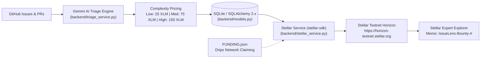

# IssueLens: AI-Powered Issue & PR Triage Dashboard with Stellar XLM Bounties & Drips Integration

[](LICENSE)
[](https://horizon-testnet.stellar.org)
[](FUNDING.json)

**IssueLens** is a full-stack triage, prioritization, and open-source bounty settlement platform built for maintainers in the **Stellar & Drips ecosystem**. It connects to GitHub repositories, ingests open Issues and Pull Requests (including comments and unified PR diffs), uses **Google Gemini (`google-genai`)** to analyze engineering complexity and missing reproduction steps, automatically prices **Stellar XLM bounties (`Low=25 XLM`, `Medium=75 XLM`, `High=150 XLM`)**, and executes **on-chain Stellar Testnet XLM payouts** with verifiable Horizon transaction hashes.

---

## Stellar XLM Bounty & Drips Integration

IssueLens bridges AI-assisted repository maintenance with instant, transparent contributor rewards on the **Stellar Network** and programmable dependency funding via **Drips**:



1. **AI Complexity-Driven XLM Bounty Pricing (`backend/models.py` & `backend/triage_service.py`)**:
   - Every synced Issue and Pull Request is evaluated for reproduction completeness, breaking signature changes, unit test coverage, and engineering complexity:
     - **Low Complexity (`25 XLM`)**: Good first issues, documentation fixes, minor UI badges, or small well-scoped enhancements.
     - **Medium Complexity (`75 XLM`)**: Standard bug reports and feature PRs requiring investigation or reproduction verification.
     - **High Complexity (`150 XLM`)**: Breaking API/signature changes, concurrency/hydration bugs, scheduler refactors, or security-sensitive changes.
2. **Stellar Testnet Horizon & Friendbot Escrow (`backend/stellar_service.py`)**:
   - Powered by `stellar-sdk>=11.0.0` connected to `https://horizon-testnet.stellar.org`.
   - Supports generating and funding Stellar Testnet escrow accounts via Friendbot (`https://friendbot.stellar.org`) and verifying contributor `G...` Ed25519 public keys (`StrKey.is_valid_ed25519_public_key`).
   - Builds, signs, and submits native `XLM` payment operations with standardized on-chain text memos (`IssueLens-Bounty-#<issue_number>`), returning the Horizon transaction hash (`stellar_tx_hash`) and the **Stellar Expert** explorer URL (`https://stellar.expert/explorer/testnet/tx/<hash>`).
   - **Zero-Config Demo Simulation Mode**: If `STELLAR_ESCROW_SECRET` is not set in `.env`, IssueLens automatically runs in deterministic demo-simulation mode so local reviewers can test 1-click XLM payouts out of the box.
3. **Drips Network Repository Funding (`FUNDING.json`)**:
   - Includes a root [`FUNDING.json`](FUNDING.json) manifest formatted for **Drips Network** claiming and continuous open-source funding split distribution across Ethereum, Optimism, and Stellar ecosystems.

---

## Key Features

- **Unified Issue & PR Triage Queue**: Browse, search, and filter open GitHub Issues and Pull Requests by status (`Needs Repro`, `Breaking Change`, `PRs`, `Issues`).
- **Automated AI Triage & Structured Output**: Uses Google Gemini (`gemini-3.8-flash`) with Pydantic v2 structured output schemas (plus deterministic local heuristics when offline) to evaluate:
  - Missing reproduction steps, minimal code snippets, or error logs (`needs_repro`)
  - Potential breaking changes in public signatures or exported endpoints (`is_breaking`)
  - Unit test coverage in Pull Request diffs
  - Suggested GitHub labels (`bug`, `repro-needed`, `enhancement`, `good-first-issue`)
  - Engineering complexity (`Low`, `Medium`, `High`) and auto-calculated `bounty_xlm` (`25.0`, `75.0`, `150.0` XLM)
- **1-Click Stellar XLM Bounty Payouts**: Pay contributors directly to their Stellar `G...` wallet address via `POST /api/issues/{issue_id}/bounty/payout` with automatic memo tagging (`IssueLens-Bounty-#<issue_number>`).
- **Live Stellar Testnet Health Monitoring**: Inspect real-time Stellar Testnet Horizon ledger status and protocol version via `GET /api/stellar/network-status`.
- **Maintainer Reply Drafting & 1-Click GitHub Posting**: Automatically drafts polite, context-aware responses that maintainers can edit and post directly back to GitHub Issues/PRs.

---

## Quick Start

### 1. Backend (`/backend`)

```bash
# Create and activate a virtual environment (Python 3.10+)
python -m venv .venv
# Windows (PowerShell):
.\.venv\Scripts\Activate.ps1
# macOS / Linux:
# source .venv/bin/activate

# Install Python dependencies (includes stellar-sdk>=11.0.0)
pip install -r backend/requirements.txt

# Configure environment variables
cp backend/.env.example backend/.env

# Start the FastAPI server
cd backend
uvicorn main:app --reload --host 0.0.0.0 --port 8000
```

### 2. Frontend (`/frontend`)

```bash
# In a new terminal (Node.js 18+)
cd frontend
npm install
npm run dev
```

### 3. Run Tests

```bash
pytest backend/tests
```

Once running, access:
- **Frontend Dashboard**: [http://localhost:5173](http://localhost:5173)
- **Backend API & Swagger Docs**: [http://localhost:8000/docs](http://localhost:8000/docs)
- **Health Check**: [http://localhost:8000/api/health](http://localhost:8000/api/health)
- **Stellar Testnet Status**: [http://localhost:8000/api/stellar/network-status](http://localhost:8000/api/stellar/network-status)

> **Docker Alternative**: Run `docker compose up --build` from the root directory to launch both services in containers.

---

## Architecture Breakdown

```text
issuelens/
├── backend/                     # FastAPI + SQLAlchemy 2.x + Pydantic v2 + Google GenAI + Stellar SDK
│   ├── tests/
│   │   └── test_issuelens.py    # Pytest suite (GitHub sync, Gemini triage, Stellar XLM payouts & Horizon status)
│   ├── main.py                  # FastAPI application, lifespan DB init/seeding, & REST endpoints
│   ├── models.py                # SQLAlchemy ORM models, complexity->XLM calculator, & Pydantic v2 schemas
│   ├── stellar_service.py       # Stellar Testnet Horizon client, Friendbot escrow, & XLM bounty payout service
│   ├── database.py              # SQLAlchemy 2.x engine, session management, & schema auto-migration
│   ├── schemas.py               # Re-exported Pydantic v2 validation schemas
│   ├── github_service.py        # Async httpx client for GitHub REST API (issues, comments, PR diffs)
│   ├── triage_service.py        # Gemini AI triage analyzer & deterministic complexity/repro heuristics
│   ├── requirements.txt         # Python dependencies (including stellar-sdk>=11.0.0)
│   ├── .env.example             # Environment variable template
│   └── Dockerfile
├── frontend/                    # React + Vite + Tailwind CSS + Lucide React
│   ├── src/
│   │   ├── components/
│   │   │   └── MarkdownRenderer.jsx
│   │   ├── App.jsx              # Main IssueLens Triage Dashboard controller
│   │   ├── main.jsx             # React DOM entry point
│   │   └── index.css            # Tailwind CSS directives & base styles
│   ├── index.html
│   ├── package.json
│   ├── vite.config.js
│   └── Dockerfile
├── FUNDING.json                 # Drips Network & Stellar ecosystem funding manifest
├── CONTRIBUTING.md              # Contributor setup, workflow, & testing guide
├── LICENSE                      # MIT License
├── docker-compose.yml
└── README.md
```

---

## Environment Configuration

Copy `backend/.env.example` to `backend/.env` and configure your credentials:

```bash
cp backend/.env.example backend/.env
```

### `backend/.env`

```dotenv
GITHUB_TOKEN=your_personal_access_token_here
GEMINI_API_KEY=your_gemini_api_key_here
STELLAR_ESCROW_SECRET=your_stellar_testnet_secret_key_here
STELLAR_HORIZON_URL=https://horizon-testnet.stellar.org
```

| Variable | Required | Default | Description |
| :--- | :---: | :--- | :--- |
| `GITHUB_TOKEN` | Recommended (Required for posting replies) | `""` | GitHub Personal Access Token (`repo` or `public_repo` scope). Increases GitHub API rate limits during repository sync and authorizes `POST /api/issues/{id}/reply`. |
| `GEMINI_API_KEY` | Recommended | `""` | Google Gemini API key used by `google-genai` for AI issue/PR triage. If omitted, IssueLens gracefully falls back to built-in heuristic analysis. |
| `STELLAR_ESCROW_SECRET` | Optional | `""` | Stellar Testnet `S...` secret seed used to sign live XLM bounty payouts. If omitted, IssueLens runs in instant **demo-simulation mode** for local testing. |
| `STELLAR_HORIZON_URL` | Optional | `https://horizon-testnet.stellar.org` | Stellar Testnet Horizon endpoint URL. |
| `DATABASE_URL` | Optional | `sqlite:///./issuelens.db` | SQLAlchemy 2.x database connection string. |

---

## API Endpoints

| Method | Endpoint | Description |
| :--- | :--- | :--- |
| `GET` | `/api/health` | Health check returning service status. |
| `GET` | `/api/stellar/network-status` | Check live Stellar Testnet Horizon ledger health and protocol status. |
| `POST` | `/api/repos/sync` | Sync open Issues, PRs, comments, and diffs from a GitHub repository (`owner/name` or URL). |
| `GET` | `/api/repos` | List all synced GitHub repositories. |
| `GET` | `/api/repos/{repo_id}/issues` | List tracked Issues and PRs (with XLM bounty metadata) for a specific repository. |
| `GET` | `/api/issues` | List tracked Issues and PRs with optional `repo_id` and `is_pr` query filters. |
| `POST` | `/api/issues/{id}/triage` | Run (or re-run) AI triage analysis on an Issue or PR, auto-calculating `bounty_xlm` (`25`/`75`/`150` XLM). |
| `POST` | `/api/issues/{issue_id}/bounty/payout` | Execute or simulate a Stellar Testnet XLM bounty payout (`Memo: IssueLens-Bounty-#<issue_number>`) to a contributor's `G...` wallet address. |
| `POST` | `/api/issues/{id}/reply` | Post the drafted (or custom) maintainer reply as a comment on GitHub. |

---

## Contributing & License

- See [CONTRIBUTING.md](CONTRIBUTING.md) for development setup and testing instructions.
- Distributed under the [MIT License](LICENSE).
